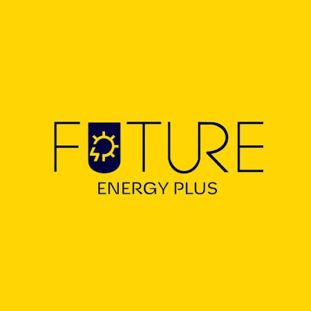

# FUTURE-ENERGY-PLUS-----------ALFA-01
# Future Energy Plus | Engenharia e Energia Solar Fotovoltaica

<p align="center">
  <strong>Soluções fotovoltaicas corporativas e residenciais de alto padrão com engenharia própria em Parnaíba e região.</strong>
</p>

<p align="center">
  
</p>

<p align="center">
  <a href="#-sobre-o-projeto">Sobre</a> •
  <a href="#-funcionalidades">Funcionalidades</a> •
  <a href="#-tecnologias">Tecnologias</a> •
  <a href="#-cases-de-sucesso">Cases</a> •
  <a href="#-como-executar">Como Executar</a>
</p>

---

## ⚡ Sobre o Projeto

A **Future Energy Plus** é uma landing page corporativa de alta performance desenvolvida para o setor de energia solar fotovoltaica. O projeto foi estruturado sob rigorosos padrões de engenharia elétrica, design tech moderno e foco absoluto em conversão de leads (corporativos e residenciais).

O site conta com seções imersivas de vídeo de fundo em loop, simulador de economia em tempo real, galeria de cases de grande porte validados e integração direta com o atendimento comercial via WhatsApp.

---

## 🚀 Funcionalidades

* **Hero Section Dinâmica:** Vídeos de fundo em loop contínuo com transição suave em fade e exibição de métricas de impacto.
* **Simulador de Fatura Interativo:** Calculadora em tempo real que estima a economia mensal e anual com base no consumo do cliente.
* **Seção de Inversores Tier 1:** Vitrine dedicada às marcas globais de elite utilizadas nos projetos (Huawei, Solis, Sungrow, SAJ, Deye).
* **Cases de Grande Porte:** Destaque especial para usinas complexas (como o sistema híbrido com baterias da Paróquia Santa Ana) e instalações em Parnaíba e Barreirinhas.
* **Captura e Redirecionamento de Leads:** Formulário otimizado com máscara de telefone e disparo direto para o WhatsApp comercial oficial.
* **Design Responsivo Avançado:** Layout totalmente fluido adaptado para desktops, tablets e dispositivos móveis.

---

## 🛠️ Tecnologias Utilizadas

Este projeto foi desenvolvido utilizando uma stack web moderna, limpa e de alta performance, sem dependências de frameworks pesados:

* **HTML5 Semantic:** Estruturação orientada a SEO e acessibilidade.
* **CSS3 Moderno:** Variáveis nativas (*CSS Custom Properties*), Grid Layout, Flexbox e efeitos de *Glassmorphism*.
* **JavaScript (ES6+):** Manipulação de DOM, lógica assíncrona do formulário e dinamismo do simulador de faturas.

---

## 🏗️ Cases de Sucesso em Destaque

1. **Paróquia Santa Ana:** Sistema híbrido de grande porte com 31,50 kWp, geração de 4.050 kWh/mês, inversores e 2 baterias de alta performance.
2. **Centro, Barreirinhas:** Usina comercial com 15,5 kWp, geração de 2.000 kWh/mês, economia de R$ 2.710,58/mês e payback de 1,21 anos.
3. **São José, Parnaíba:** Sistema comercial de 15,60 kWp com economia mensal de R$ 2.755,20.

---

## ⚙️ Como Executar o Projeto Localmente

Para rodar o projeto em sua máquina para fins de desenvolvimento ou testes:

1. Clone o repositório:
   ```bash
   git clone [https://github.com/SEU-USUARIO/future-energy-plus.git](https://github.com/SEU-USUARIO/future-energy-plus.git)
